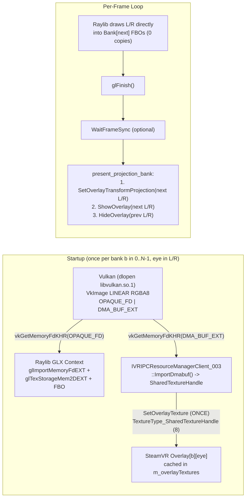

# DMA-BUF Overlay Bank Visibility-Flip (Zero-Copy Coherent Presentation)

**Status:** Implemented and verified end-to-end on Linux (default `dmabufBanks = 3`, live-switchable between `3`, `2`, and legacy GL `0`).
**Target SteamVR build (static & runtime RE):**
- `vrcompositor` BuildID `9043766964b1831d8df849a867c1df0418413cd4` (SteamVR 2.18.4, Linux x86_64)
- `vrclient.so` BuildID `389a25296fd69b28aa176eff07d55ac5826b0961`

---

## 1. TL;DR

PetPlay's projection overlays previously suffered from pose/image desync and frame-pacing judder on SteamVR because calling `SetOverlayTexture` + `SetOverlayTransformProjection` every frame hits two structural limitations in `vrcompositor`:

1. **Pose and texture are read in separate snapshots.** `PushUpdatesToScenegraph` reads the projection matrix under one shared-memory guard, while `ComputeSystemLayerParams` reads the 5-entry texture ring under a later guard (0.24–2.13 ms apart).
2. **`TextureType_OpenGL` (and `TextureType_Vulkan`) copy on every submit.** `SetOverlayTexture` blits into SteamVR's internal Vulkan ring and queues an asynchronous GPU copy whose completion semaphore is not awaited by the compositor's final draw pass.

The workaround—originally discovered by [SafariMonkey](https://github.com/SafariMonkey) (*"keep multiple overlays, bind each shared texture once, update the hidden backing memory, and flip visibility"*)—turns out to be **architecturally exact** against `vrcompositor`'s internals on Linux when backed by **`TextureType_SharedTextureHandle` (8, DMA-BUF)**:

- `vrcompositor` caches imported DMA-BUF textures in `CGraphicsDevice::m_overlayTextures[128][5]` and **never evicts them on `HideOverlay`** (only on overlay destruction).
- `DrawProjectionOverlay` samples the cached imported texture directly every frame—**zero `SetOverlayTexture` calls and zero re-imports** after initial setup.
- `PushUpdatesToScenegraph` reads **both** an overlay's visibility flag (`+0x5a1d` bit 3) and its projection transform (`+0x560c`) **under the same shared-memory guard**.
- By rendering into an off-screen bank `B` (one left/right overlay pair per bank), waiting for GPU completion, and then flipping pose + visibility from `prevBank` to `B`, pose and pixels are bound to the same bank identity and published in **~0.5–1.3 µs** (vs **~220 µs** for the GL baseline).
- Using **3 banks** (default) instead of 2 gives a full extra frame of retirement margin after `SendOverlayVSyncEvent` (which fires at GPU *submit*, before GPU *completion*) at the exact same ~1 µs flip cost.

PetPlay's native presenter ([native/overlayPresenter/](../../native/overlayPresenter/)) is now implemented in **pure Zig** (zero C++, zero `libstdc++`, zero hard link to `libvulkan`).

---

## 2. Why the Legacy OpenGL Path Judders

Prior RE in this directory ([deep-dive.md](deep-dive.md), [compositor-snapshot.md](compositor-snapshot.md), [compositor-semaphores.md](compositor-semaphores.md)) established three root causes when presenting a single stereo overlay pair via `SetOverlayTexture(TextureType_OpenGL)` + `SetOverlayTransformProjection`:

1. **Split pose vs. texture snapshot:**
   - `PrepareForFrame` → `PushUpdatesToScenegraph` reads the projection matrix (`+0x560c`) into the scenegraph.
   - Later in the same frame, `ComputeSystemLayerParams` takes a *second* shared-memory lock and reads the active texture ring index (`+0x5570`) and handle (`+0x548c`).
   - Any client update landing in the 0.24–2.13 ms gap between those two reads produces a **mixed generation** (old pixels warped with new pose, or new pixels warped with old pose)—experienced in-headset as world-locked / controller-locked swim and judder.
2. **Unsynchronized copy-on-submit:**
   - `TextureType_OpenGL` (type `1`) and `TextureType_Vulkan` (type `4`) do **not** share client backing memory directly with `vrcompositor`. `vrclient.so` blits (`glBlitFramebuffer`) into a staging `CVRSharedGLTexture` and submits a secondary Vulkan copy into the overlay's 5-entry ring.
   - The compositor's final draw submission does not wait on that secondary copy's completion semaphore, so heavy GPU load can cause `vrcompositor` to sample an in-flight or stale copy.
3. **No compositor latch fence:**
   - `IVROverlay_029::WaitLatchSync` waits on `VR_Compositor_OverlayLatched0/1`, which `vrcompositor` creates but **never signals**. Only `VR_Compositor_OverlayVSync0/1` (`WaitFrameSync`) is signaled.

---

## 3. Static Reverse Engineering Findings

Disassembly of `vrcompositor` (`9043766964b1831d8df849a867c1df0418413cd4`) and `vrclient.so` (`389a25296fd69b28aa176eff07d55ac5826b0961`) confirmed every prerequisite of the bank-flip design:

| Component / Function | Address (vaddr) | Verified Behavior |
| --- | --- | --- |
| `CGraphicsDevice::m_overlayTextures[128][5]` | `this + 0x1df8` | Per-overlay, per-subslot cache of imported Vulkan images. Populated lazily by `UpdateOverlayTexture` (`0x172ef0`, uprobe `0x171ef0`) → `ImportTextureFromSharedHandle` (`0x3ecc50`, uprobe `0x3ebc50`). |
| Overlay texture eviction | `0x177740` | Cache entries are **only** cleared when the overlay is destroyed—**never** on `HideOverlay`. Hidden banks keep their imported Vulkan image alive indefinitely. |
| `DrawProjectionOverlay` | `0x189630` | Samples directly from `m_overlayTextures[slot][subslot]` every compositor frame without re-importing or copying. |
| `PushUpdatesToScenegraph` | `0x2413f0` (uprobe `0x2403f0`) | Reads projection matrix (`+0x560c`) and visibility flag (`+0x5a1d` bit 3, uprobe `0x240917`) under the **same** shared-memory lock guard. |
| `CGraphicsDevice::Present` | `0x196660..0x1966f9` | Submits compositor GPU frame `N`, immediately calls `SendOverlayVSyncEvent` (`0x182930`, uprobe `0x181930`), and **only afterward** waits for GPU completion (`0x1829b0`). |
| `IVRIPCResourceManagerClient_003::ImportDmabuf` | vtable slot 2 (Linux `vrclient.so`) | Imports a client-exported DMA-BUF FD (`DmabufAttributes_t`, `sizeof = 104`, natural 8-byte alignment: `offsetof(ulModifier) = 40`, `offsetof(plane) = 52`) and returns a `SharedTextureHandle_t` (`uint64`) accepted by `SetOverlayTexture(..., TextureType_SharedTextureHandle)`. |

### Why `SendOverlayVSyncEvent` Ordering Matters (2-Bank vs. 3-Bank)

Because `SendOverlayVSyncEvent` fires right after `vkQueueSubmit`—**before** the compositor's GPU has finished rasterizing frame `N`:

- **With 2 banks (`A`, `B`):** If the client wakes on `WaitFrameSync`, immediately begins rendering frame `N+1` into the previously-visible bank `A`, and `vrcompositor`'s GPU work for frame `N` was delayed (e.g. heavy VRChat / compositor load), the client's GPU write into `A` can race with the compositor's GPU read of `A`.
- **With 3 banks (`A`, `B`, `C`):**
  - Bank `A` is currently visible / being sampled by the compositor's GPU for frame `N`.
  - Bank `B` was just retired and sits untouched for one full vsync while the compositor's GPU finishes draining.
  - Bank `C` is completely idle and safe for the client to render frame `N+1` into immediately.

In both 2-bank and 3-bank modes, the per-frame flip cost is identical (~1 µs), and the compositor only draws the one visible bank. The only cost of 3 banks is one extra eye-pair of VRAM (~12 MB at 1024² RGBA8, or ~150 MB at 3560² RGBA8).

---

## 4. Runtime RE & Heavy-Load Stress Testing

Before touching PetPlay's runtime, we validated the mechanism end-to-end in a scoped synthetic SteamVR lab (`utils/petplay-ovrdriver-lab.py run --direct-server --x11-compositor --headless-display --present-proof ...`) with tracefs uprobes attached directly to `vrcompositor` (`UpdateOverlayTexture`, `ImportTextureFromSharedHandle`, `PushUpdatesToScenegraph`, `vis_read`, `SendOverlayVSyncEvent`) and pixel-exact frame decode on the compositor's actual output images.

Test scripts and raw logs live in `_scratch/dmabuf-bank-re/`.

### Stress Test Matrix (AMD Radeon RX 7900 XTX, Mesa 26.2.6)

| Run | Banks | Resolution & Layout | Load | Generations | Re-imports in Loop | Multi-bank / Split-eye Snapshots | L/R Pose Mismatches | Composited Pixel Decode | Flip Latency |
| --- | --- | --- | --- | --- | --- | --- | --- | --- | --- |
| `run-linear-3bank` | 3 | 512² mono, linear (`mod=0x0`, 1 plane) | Light | 120 | **0** (3 initial) | 0 / N/A | N/A | 16/16 clean | avg **0.9 µs** (max 2.9 µs) |
| `run-tiled-2bank-2048` | 2 | 2048² mono, GFX11 DCC (`0x200000028a6bf04`, 2 planes) | Light | 120 | **0** (2 initial) | 0 / N/A | N/A | 16/16 clean | ~1 µs |
| `run-tiled-3bank-2048` | 3 | 2048² mono, GFX11 DCC (`0x200000028a6bf04`, 2 planes) | Light | 120 | **0** (3 initial) | 0 / N/A | N/A | 16/16 clean | ~1 µs |
| `super-heavy-2bank` | 2 | **3560×3560 stereo**, GFX11 DCC (`0x200000028a37f04`, 3 planes) | **24 CPU threads + 4096² 2000-iter GPU hog** (`render_ms` p50=26.05 ms, max=30.13 ms) | 180 | **0** | **0** / **0** (92/92 coherent) | **0** | **9/9 stereo OK, 0 mismatch, 0 torn** | p50 **1.2 µs**, p95 **1.3 µs** |
| `super-heavy-3bank` | 3 | **3560×3560 stereo**, GFX11 DCC (`0x200000028a37f04`, 3 planes) | **24 CPU threads + 4096² 2000-iter GPU hog** (`render_ms` p50=25.98 ms, max=30.35 ms) | 180 | **0** | **0** / **0** | **0** | **9/9 stereo OK, 0 mismatch, 0 torn** | p50 **1.2 µs**, p95 **1.2 µs**, max **1.3 µs** |

Every single decoded composited frame had `std = 0.0` and `purity = 255.0` across both left and right eyes, confirming:
- `vrcompositor` sampled the exact updated pixels written into the shared DMA-BUF without calling `SetOverlayTexture` again.
- Zero tearing, zero DCC corruption, and zero L/R generation splits even while the GPU was saturated at ~26–30 ms per frame and all 24 CPU threads were pegged.

---

## 5. PetPlay Architecture & Pure-Zig Implementation

### Dataflow

### Key Engineering Details

1. **Vulkan → GLX + DMA-BUF Dual Export (no EGL required):**
   - Raylib on Linux uses GLFW + X11 + **GLX** (`eglGetCurrentDisplay()` is null), so EGL DMA-BUF import is unavailable.
   - Instead, `dmabuf_banks.zig` dynamically loads `libvulkan.so.1` via `dlopen` (zero link-time dependency), creates a headless Vulkan device with `VK_KHR_external_memory_fd` + `VK_EXT_external_memory_dma_buf`, and allocates each eye's backing `VkImage` (`VK_FORMAT_R8G8B8A8_UNORM`, `VK_IMAGE_TILING_LINEAR`, `handleTypes = OPAQUE_FD_BIT | DMA_BUF_BIT_EXT`).
   - From the same `VkDeviceMemory`, it exports:
     - an **opaque FD** imported into Raylib's GLX context via `GL_EXT_memory_object` / `GL_EXT_memory_object_fd` (`glImportMemoryFdEXT`, `glTexStorageMem2DEXT` with `GL_LINEAR_TILING_EXT`) and attached to a dedicated GL FBO + depth renderbuffer; and
     - a **DMA-BUF FD** (`DRM_FORMAT_ABGR8888 = 0x34324241`, `ulModifier = 0`, `unStride = subresourceLayout.rowPitch`) passed once to `IVRIPCResourceManagerClient_003::ImportDmabuf` and bound once to the bank's overlay via `SetOverlayTexture(..., TextureType_SharedTextureHandle)`.
2. **Y-Axis Orientation (`applyTextureBounds(true)`):**
   - OpenGL FBO rendering is bottom-up, whereas Vulkan/DMA-BUF sampling in `vrcompositor` is top-down.
   - `OpenVrProjectionOverlayPair.applyTextureBounds(invertVForDmabuf)` flips `vMin`/`vMax` on DMA-BUF bank overlays so the rendered scene appears upright without an extra shader flip or blit.
3. **Pure-Zig Native Library (No C++):**
   - All C++ sources (`presenter.cpp`, `presenter_test.cpp`, `dmabuf_banks.cpp`) were replaced with pure Zig:
     - [native/overlayPresenter/build.zig](../../native/overlayPresenter/build.zig)
     - [native/overlayPresenter/src/presenter.zig](../../native/overlayPresenter/src/presenter.zig)
     - [native/overlayPresenter/src/dmabuf_banks.zig](../../native/overlayPresenter/src/dmabuf_banks.zig)
   - `IVRIPCResourceManagerClient_003` is called through an explicit `extern struct` vtable (`vtable[2]` = `ImportDmabuf`), avoiding C++ ABI / compiler devirtualization hazards (GCC `-O2` previously mis-devirtualized an anonymous-namespace abstract class into `__cxa_pure_virtual`).
   - `DmabufAttributes` layout is enforced at compile time (`comptime` assertions on `size == 104`, `ulModifier == 40`, `plane == 52`).
   - Built via `deno run -A utils/build-overlay-presenter.ts` (`zig build -Doptimize=ReleaseFast`). `ldd resources/libpetplay_overlay_presenter.so` links only `libc.so.6` and `libGL.so.1` (no `libstdc++`, no `libgcc_s`, no `libvulkan`).
4. **TypeScript Integration & Runtime Controls:**
   - [classes/overlayPresenterNative.ts](../../classes/overlayPresenterNative.ts): FFI bindings for `dmabuf_pool_*`, `dmabuf_bind_overlay`, and `present_projection_bank`.
   - [classes/openVrProjectionOverlays.ts](../../classes/openVrProjectionOverlays.ts): `applyTextureBounds(invertVForDmabuf)` and per-bank overlay pairs.
   - [classes/webxrOverlayRaylib.ts](../../classes/webxrOverlayRaylib.ts): `setExternalEyeBanks`, `selectExternalEyeBank`, `getPreferredEyeSize`—renders Raylib/Raythree directly into the selected bank's FBO with zero copies.
   - [petplay/overlayRenderOwner.ts](../../petplay/overlayRenderOwner.ts):
     - `dmabufBanks: 0 | 2 | 3` (default **`3`** on Linux, `0` on non-Linux).
     - Configurable via `PETPLAY_DMABUF_BANKS=0|2|3`, `STARTOVERLAYRENDERER` payload, or live-switched at runtime via `SETRENDERERDEBUG` (`{ dmabufBanks: 3 | 2 | 0 }`).
     - Gracefully falls back to the legacy GL baseline (`0`) if Vulkan/GLX/DMA-BUF initialization or `ImportDmabuf` fails.

### End-to-End Verification (`_scratch/dmabuf-bank-re/e2e-owner-test.ts`)

Running the full `overlayRenderOwner` actor + Raylib + pure-Zig `libpetplay_overlay_presenter.so` against synthetic SteamVR with live runtime mode switching:

| Mode | Frames Published | `waitTimeouts` | `gpuFinishMs` | `publicationMs` | Errors |
| --- | --- | --- | --- | --- | --- |
| **3-bank DMA-BUF** | 158 | 0 | 0.20 ms | **0.00126 ms** (1.26 µs) | 0 |
| **Live switch → 2-bank DMA-BUF** | 269 | 0 | 0.21 ms | **0.00112 ms** (1.12 µs) | 0 |
| **Live switch → Legacy GL (`0`)** | 327 | 0 | 0.19 ms | **0.22351 ms** (223.5 µs) | 0 |
| **Live switch → 3-bank DMA-BUF** | 389 | 0 | 0.21 ms | **0.00054 ms** (0.54 µs) | 0 |

Composited proof frames (`--present-proof`) were visually inspected to verify upright orientation, exact RGB color fidelity, and clean alpha blending.

---

## 6. Known Limitations & Future Work

1. **Stereo flip window (~1 µs):**
   - OpenVR has no single multi-overlay atomic commit API. `present_projection_bank` executes 4–6 shared-memory writes in tight native C/Zig order (`SetOverlayTransformProjection` L/R on `nextBank`, `ShowOverlay` L/R on `nextBank`, `HideOverlay` L/R on `prevBank`).
   - While this shrinks the inter-eye / visibility window by ~200× (from >220 µs + async GPU copy down to ~1 µs of pure shared-memory writes) and produced 0 split-eye snapshots across all stress tests, a compositor `PushUpdatesToScenegraph` landing inside that ~1 µs window is theoretically possible if `WaitFrameSync` is disabled or heavily jittered.
2. **Explicit `glFinish()` before flip:**
   - Currently the renderer calls `glFinish()` before flipping visibility so the bank's pixels are guaranteed landed in VRAM before `vrcompositor` samples them (~0.20 ms at 1024²).
   - Because `vrcompositor` does not expose a per-overlay external Vulkan semaphore wait on the cached DMA-BUF path, client-side completion (`glFinish` or a GL fence wait) is required to guarantee zero partial-draw sampling.
3. **Linear vs. Tiled/DCC Modifiers:**
   - The production Zig pool currently allocates `VK_IMAGE_TILING_LINEAR` (`DRM_FORMAT_MOD_LINEAR = 0`) for maximum portability across AMD/NVIDIA/Intel GLX + Vulkan drivers.
   - Our RE probes already proved 2-plane and 3-plane AMD GFX11 DCC tiled modifiers work cleanly through `ImportDmabuf`; adding `VK_EXT_image_drm_format_modifier` negotiation is an optional future optimization if memory bandwidth at very high eye resolutions becomes a bottleneck.
4. **Windows Backend (Not Yet Implemented):**
   - Windows does not have DMA-BUF; the equivalent zero-copy path is **`TextureType_DXGISharedHandle` (5)** backed by D3D11 shared textures (`D3D11_RESOURCE_MISC_SHARED` / `IDXGIResource::GetSharedHandle`) imported into Raylib's WGL context via **`WGL_NV_DX_interop2`** (`wglDXOpenDeviceNV`, `wglDXRegisterObjectNV`, `wglDXLockObjectsNV` / `wglDXUnlockObjectsNV`).
   - Until implemented, non-Linux platforms default to `dmabufBanks = 0` (legacy GL path).

---

## 9. Follow-Up Addendum

See [dmabuf-bank-pacing-and-pipelining.md](dmabuf-bank-pacing-and-pipelining.md) for the stereo-panorama bank-flip extension, Linux decoupled default, `vsync-locked` + 1-frame async GPU fence pipelining under VRChat GPU contention (zero `sudo`), GC churn reductions, and a detailed review against [SafariMonkey](https://github.com/SafariMonkey)'s visibility-swap and symmetric-frustum findings.
