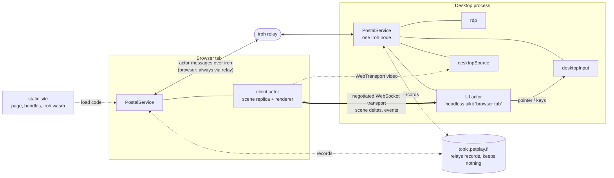

# How one RDP tab connects

Status: plan (2026-11-20). One tab for now.

## Pieces



## Sequence

```mermaid
sequenceDiagram
  autonumber
  participant C as client actor (browser)
  participant T as topic server
  participant U as UI actor (desktop)

  U->>T: join hash(secret) {actorId, iroh {id, relay}}
  Note over C: page opens later
  C->>T: join hash(secret) {actorId, iroh {id, relay}}
  T-->>U: client's record
  U->>C: dial iroh, send own record (TOPICRECORD)
  Note over C,U: both are contacts now; messages route over iroh
  C->>U: Transport.open(U, purpose "rdp.ui", params {secret})
  U-->>C: answer: webtransport {url, cert hash}, UI actor listens
  C->>U: WebTransport connect, pinning the hash (direct over the tailnet)
  C->>U: viewport, DOM events
  U-->>C: scene deltas (latest since ack)
```

The topic server only ever sees `{actorId, iroh id, relay}`. Everything else, including the
WebTransport descriptor, its token and the certificate hash, travels over the iroh connection, which is end-to-end
encrypted.

## Access

The link's fragment is a random session secret, never sent to the page's host. The topic is a
hash of it, because the public topic server relays topic names in the clear. Anyone can still
dial the UI actor's process once they see the hash; the UI actor closes any `rdp.ui` transport
whose offer lacks the secret, and the offer travels only over the encrypted iroh connection.

## The page's origin

The page holds no secrets, so any https host can serve it. An https page can neither open
`ws://` nor trust a self-signed certificate on its own, so the UI connection is WebTransport
(stageforge's `webtransport` kind): the UI actor listens on Deno's QUIC server (`--unstable-net`)
with a certificate it makes itself (`rdp/classes/selfSignedCert.ts`: ECDSA P-256, 13 days,
renewed after 12), and the descriptor carries the certificate's SHA-256, which the browser pins
(`serverCertificateHashes`). No CA, no public certificate log entry for the machine's name. The
tab still offers `websocket` second, for a page served over plain http on the same host.

## Open

- Hosting the page on an https site (rdp.petplay.fi).
