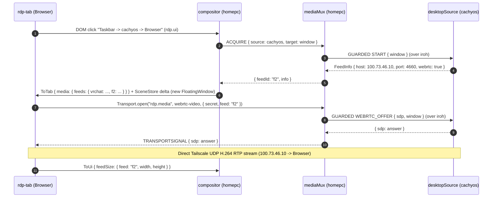
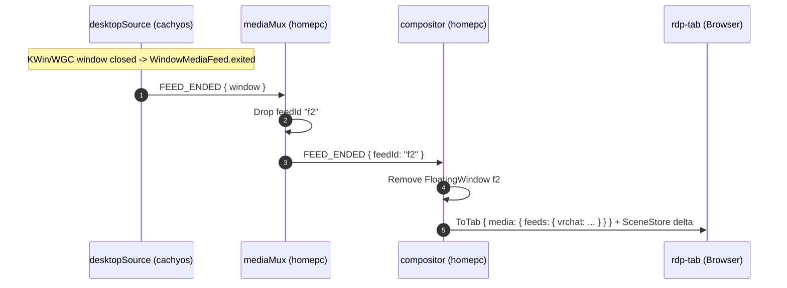

# PetPlay Universal Multiplexer & Multi-Machine Compositor

Status: concrete architecture plan (2026-11-23). Builds on `README.md`, `connection.md`, `peers.md`, `tailscale-webrtc.md`, `../window-capture.md`, and `../../submodules/stageforge/markdown/design-invariants.md`.

## Goal

Express PetPlay's remote desktop / multi-machine compositor as a **graph of concrete StageForge actors** with explicit message contracts, negotiated transports, and cleanly separated non-actor modules and native helpers — so building wild multiplexed apps (like a fake desktop compositor with a taskbar, windows running on different machines, and VRChat running as the wallpaper) is just composing actors and pure React/uikit components.

---

## StageForge Actor & Module Graph (Browser at Top)

### Legend
- **Hexagon** (`{{...}}`): non-shareable `System` proto-actor (minimal main-thread runtime enabler)
- **Stadium** (`([...])`): StageForge **Actor** (own worker, `ActorId`, messages, transports)
- **Rectangle** (`[...]`): pure **TS / React / uikit Module** living inside an actor
- **Subroutine** (`[[...]]`): **Native Binary / WASM** helper process or runtime
- **Cylinder** (`[(...)]`): **External Relay / Service**
- `-->` StageForge actor messages · `==>` negotiated StageForge `Transport` · `-.->` discovery / native IPC / media

```mermaid
flowchart TB
  classDef proto fill:#3b2f4a,stroke:#c084fc,stroke-width:2px,color:#f3e8ff
  classDef actor fill:#1e3a5f,stroke:#60a5fa,stroke-width:2px,color:#eff6ff
  classDef module fill:#1f2937,stroke:#9ca3af,stroke-dasharray:4 3,color:#e5e7eb
  classDef native fill:#3f2e1e,stroke:#f59e0b,stroke-width:1.5px,color:#fef3c7
  classDef service fill:#1e3a3a,stroke:#2dd4bf,stroke-width:1.5px,color:#ccfbf1

  subgraph BROWSER_PROC["Browser Tab - rdp/browser/page.ts (PostalService)"]
    direction TB
    PAGE{{"System: page.ts (Main Thread)\nDOM events, OffscreenCanvas\nRTCPeerConnection + hidden video"}}:::proto
    WASM[["WASM: iroh-web\npetplay_link_web.wasm"]]:::native

    BLIAISON(["Actor: rdp-liaison\nrdp/liaison.ts (client mode)"]):::actor
    TAB(["Actor: rdp-tab\nrdp/browser/client.ts (Web Worker)"]):::actor
    SV["Module: SceneView + SceneStore\nWebGL2 multi-feed textures + crops"]:::module
    MF["Module: MediaFeeds + WebRtcClient\nWebTransport/WebCodecs or webrtc-video"]:::module

    PAGE -.->|"remote carrier"| WASM
    PAGE <==>|"Transport: page.bridge (messageport)\nDOM, viewport, ImageBitmaps, SDP"| TAB
    BLIAISON -->|"ADDCONTACT + DIRECTORY\n{ ui, mediaMux }"| TAB
    TAB --- SV
    TAB --- MF
  end

  TOPIC[("Service: topic.petplay.fi\npublic discovery relay")]:::service

  subgraph HOST_PROC["Host Process - homepc (PostalService)"]
    direction TB
    RDP(["Actor: rdp\nrdp/rdp.ts (supervisor)"]):::actor
    HLIAISON(["Actor: rdp-liaison\nrdp/liaison.ts (host mode)"]):::actor
    SITE(["Actor: rdp-site\nrdp/site.ts (static HTTP)"]):::actor

    subgraph COMP_BOX["Hot-Reloadable UI Layer"]
      COMP(["Actor: compositor\nrdp/compositor.tsx\nMulti-viewer tabs Map"]):::actor
      BTAB["Module: BrowserTab + SceneFeed\nHeadless R3F + uikit deltas"]:::module
      UI_COMPS["Modules: rdp/components/\nWallpaperFeed, FloatingWindow, Taskbar"]:::module
      COMP --- BTAB
      BTAB --- UI_COMPS
    end

    subgraph MUX_BOX["Long-Lived Multiplexer Layer"]
      MUX(["Actor: mediaMux\nrdp/mediaMux.ts"]):::actor
      INP(["Actor: inputRouter\nrdp/inputRouter.ts"]):::actor
      HC["Module: HouseholdClient\nrdp/classes/household.ts\nCached HMAC proofs + GUARDED RPC"]:::module
      MUX --- HC
      INP --- HC
    end

    subgraph LOCAL_SRC_BOX["Local Sources & Sinks - homepc"]
      VRC(["Actor: vrchatSource\nrdp/vrchatSource.ts"]):::actor
      LSRC(["Actor: desktopSource\nrdp/desktopSource.ts"]):::actor
      LIN(["Actor: desktopInput\nrdp/desktopInput.ts"]):::actor

      OVR[["Native: petplay_ovrdriver\nSteamVR Vulkan DMA-BUF"]]:::native
      PM_VRC[["Native: petplay-media\nVA-API H.264 + str0m WebRTC"]]:::native
      SS_KDE[["Native: screen-streamer\nKDE Wayland zkde_screencast"]]:::native
      PM_KDE[["Native: petplay-media\nVA-API H.264 + str0m WebRTC\n(Stage 2: GPU Atlas)"]]:::native
      UIN[["Native: screen-streamer --input-only\nLinux uinput"]]:::native

      VRC -.-> PM_VRC
      OVR -.->|"DMA-BUF seqpacket"| PM_VRC
      LSRC -.-> SS_KDE
      SS_KDE -.->|"DMA-BUF seqpacket"| PM_KDE
      LSRC -.-> PM_KDE
      LIN -.->|"stdin verbs"| UIN
    end

    HOST_LINK[["Native: petplay-media link\niroh endpoint"]]:::native

    RDP -->|"START"| HLIAISON
    RDP -->|"START / SERVE"| SITE
    RDP -->|"START"| MUX
    RDP -->|"START"| INP
    RDP -->|"START"| COMP
    RDP -->|"START"| VRC
    RDP -->|"START"| LSRC
    RDP -->|"START"| LIN
  end

  subgraph CACHY_PROC["Remote Agent - cachyos (petplay-agent)"]
    CSRC(["Actor: desktopSource\nGUARDED"]):::actor
    CIN(["Actor: desktopInput\nGUARDED"]):::actor
    CSS[["Native: screen-streamer + petplay-media\nVA-API H.264 + str0m WebRTC"]]:::native
    CUIN[["Native: screen-streamer --input-only"]]:::native
    CSRC -.-> CSS
    CIN -.-> CUIN
  end

  subgraph WIN_PROC["Remote Agent - windows (petplay-agent.exe)"]
    WSRC(["Actor: desktopSource\nGUARDED"]):::actor
    WIN(["Actor: desktopInput\nGUARDED"]):::actor
    WWGC[["Native: petplay-media capture-wgc\nWGC CreateForWindow + MFT H.264 + str0m"]]:::native
    WSEND[["Native: SendInput + SetForegroundWindow"]]:::native
    WSRC -.-> WWGC
    WIN -.-> WSEND
  end

  %% Discovery (only rdp-liaison touches rdp-<id>)
  BLIAISON -.->|"join rdp-<id>"| TOPIC
  HLIAISON -.->|"join rdp-<id>"| TOPIC
  BLIAISON <-->|"HELLO { secret } -> ADDCONTACT + DIRECTORY\n(attaches direct routes over iroh)"| HLIAISON
  MUX -.->|"join household"| TOPIC
  CSRC -.->|"join household"| TOPIC
  WSRC -.->|"join household"| TOPIC

  %% Browser <-> Host Transports
  TAB <==>|"Transport: rdp.ui\nwebsocket or webtransport\nSceneStore deltas, camera, feeds, DOM, feedSize"| COMP
  TAB <==>|"Transport: rdp.media (per active feedId)\nwebrtc-video (or direct WebTransport)\nSDP over TRANSPORTSIGNAL -> H.264 + Opus RTP"| MUX

  %% Host internal actor edges
  COMP -->|"LISTSOURCES, LISTWINDOWS\nACQUIRE, RELEASE, FOCUS"| MUX
  MUX -->|"FEEDS_UPDATED, FEED_ENDED"| COMP
  COMP <==>|"Transport: rdp.input (messageport)\nRoutedInput + region + titlebarTrim"| INP
  INP <==>|"Transport: rdp.input (messageport)\nInputEvent"| LIN

  %% MediaMux -> Sources
  MUX -->|"FEED, WEBRTC_OFFER"| VRC
  MUX -->|"LISTWINDOWS, START, STOP, FOCUSWINDOW, WEBRTC_OFFER"| LSRC
  MUX -->|"GUARDED over iroh"| CSRC
  MUX -->|"GUARDED over iroh"| WSRC
  LSRC -.->|"FEED_ENDED"| MUX
  CSRC -.->|"FEED_ENDED"| MUX
  WSRC -.->|"FEED_ENDED"| MUX

  %% InputRouter -> Remote Inputs
  INP -->|"GUARDED INPUT, RELEASEALL over iroh"| CIN
  INP -->|"GUARDED INPUT, RELEASEALL over iroh"| WIN
```



---

## Actor & Module Catalogue

### Actors & Proto-Actors

| Actor | File | Runs In | Topics | Transports | Responsibility |
| :--- | :--- | :--- | :--- | :--- | :--- |
| `System` (proto-actor) | `rdp/browser/page.ts` | Browser Main Thread | *none (non-shareable)* | Accepts `page.bridge` (`messageport`) from `rdp-tab` | Minimal main-thread runtime enabler: DOM events, `OffscreenCanvas`, `RTCPeerConnection` + `<video>` → zero-copy `ImageBitmap` transfer. |
| `rdp-liaison` | `rdp/liaison.ts` | Browser Web Worker & Host Deno Worker | `rdp-<id>` (the **only** session actor on the topic) | — | Shared rendezvous & directory actor: authenticates `HELLO { secret }`, shares direct service `ActorId`s via transport-decoupled `ADDCONTACT`, and pushes `DIRECTORY` updates on hot-reload. |
| `rdp-tab` | `rdp/browser/client.ts` | Browser Web Worker | *none* (receives directory from local `rdp-liaison`) | Opens `page.bridge` (`messageport`) to `System`; opens `rdp.ui` (`websocket`/`webtransport`) to `compositor`; opens `rdp.media` (`webrtc-video`) to `mediaMux` per `feedId` | Renders `SceneStore` replica + N named video textures with `crop` rects; forwards DOM events and per-feed `feedSize`. |
| `rdp` | `rdp/rdp.ts` | Host Deno Worker | — | — | Composes and wires the actor graph (`liaison`, `site`, `mediaMux`, `inputRouter`, `compositor`, local sources). |
| `rdp-site` | `rdp/site.ts` | Host Deno Worker | — | — | Serves static `dist/rdp/` over plain HTTP on the Tailscale IP. Zero secrets. |
| `mediaMux` | `rdp/mediaMux.ts` | Host Deno Worker | `household` (if configured) | Accepts `rdp.media` (`webrtc-video`) from `rdp-tab` | Long-lived stream & household owner: discovers sources, caches `GUARDED` proofs, refcounts `ACQUIRE`/`RELEASE` (`feedId -> { source, target, crop, audio? }`), brokers `WEBRTC_OFFER` per `feedId`, relays `FEED_ENDED`. |
| `inputRouter` | `rdp/inputRouter.ts` | Host Deno Worker | — | Accepts `rdp.input` (`messageport`) from `compositor`; opens `rdp.input` (`messageport`) to local `desktopInput` | Long-lived input owner: maps per-window `(u,v)` through `region` + titlebar trim; routes `InputEvent` to local or remote `GUARDED` `desktopInput`; releases held keys on focus switch / disconnect. |
| `compositor` | `rdp/compositor.tsx` | Host Deno Worker | *none* (introduced by `rdp-liaison`) | Accepts `rdp.ui` (`websocket`/`webtransport`) from **1..N** `rdp-tab` viewers; opens `rdp.input` (`messageport`) to `inputRouter` | **Hot-reloadable** UI/WM layer: holds `tabs: Map<id, { tab, feed: SceneFeed }>`, wallpaper + floating windows + z-order + taskbar state; reloading `compositor` never drops encoders or capture sessions. |
| `vrchatSource` | `rdp/vrchatSource.ts` | Host Deno Worker | optional `household` | — | Wraps `petplay_ovrdriver` → `petplay-media` behind the standard `MediaSource` actor contract (`DESCRIBE`, `FEED`, `WEBRTC_OFFER`). |
| `desktopSource` | `rdp/desktopSource.ts` | Host & Remote Agents | `household` (if configured) | — | Captures desktop/monitors/windows (KDE Wayland `zkde_screencast_unstable_v1` or Windows WGC `CreateForWindow`) → `petplay-media`. Pushes `FEED_ENDED` when a captured window closes. |
| `desktopInput` | `rdp/desktopInput.ts` | Host & Remote Agents | `household` (if configured) | Accepts `rdp.input` (`messageport`) locally | Injects mouse/keyboard via Linux uinput or Windows `SendInput` (and future `CLIPBOARD_GET`/`CLIPBOARD_SET`). |

### Pure Modules (Non-Actors)

| Module | File | Lives Inside | Responsibility |
| :--- | :--- | :--- | :--- |
| `HouseholdClient` | `rdp/classes/household.ts` | `mediaMux`, `inputRouter`, `householdDesktops` | Caches HMAC proofs per target actor and wraps `GUARDED` RPCs in one line. |
| `BrowserTab` + `SceneFeed` | `rdp/classes/browserTab.ts`, `sceneFeed.ts` | `compositor` | Headless R3F + uikit surface and latest-since-ack `SceneStore` delta encoder (one `SceneFeed` per attached viewer in `tabs`). |
| `Compositor UI` | `rdp/components/` | `compositor` | Pure React/uikit primitives: `<WallpaperFeed>`, `<FloatingWindow>` (drag, resize, z-focus, minimize, close, mute, machine badge), `<Taskbar>`. |
| `SceneView` + `MediaFeeds` | `web/scene-stream/sceneView.ts`, `mediaFeeds.ts` | `rdp-tab` | Replicates `SceneStore` to Three.js WebGL2, uploads `VideoFrame | ImageBitmap` per `feedId` with `crop`, sorts `videoSurface` + uikit in z-order. |

---

## Exact Message & Transport Contracts

### 1. Standard `MediaSource` Actor Contract
Implemented by **`desktopSource`** (every machine) AND **`vrchatSource`** (VR host):

```ts
DESCRIBE      () -> { machine: string; kind: "desktop" | "vrchat"; input: ActorId | null; screens?: ScreenInfo[]; audio?: boolean }
LISTWINDOWS   () -> WindowInfo[]                      // desktopSource (KDE / Windows)
START         (req?: { monitor?: number; window?: string }) -> FeedInfo
STOP          (req?: { monitor?: number; window?: string }) -> true
FEED          (req?: { monitor?: number; window?: string }) -> FeedInfo | null
FOCUSWINDOW   ({ window: string }) -> true            // desktopSource
WEBRTC_OFFER  ({ sdp: string; monitor?: number; window?: string }) -> { sdp: string }
SUBSCRIBE_END ({ actor: ActorId }) -> true            // pushes FEED_ENDED { window? } on close
```

`FeedInfo` carries an optional `crop` (for Stage 2 GPU atlasing) and optional `audio`:

```ts
export type FeedInfo = {
  host: string;
  port: number;
  fingerprint: string;
  code?: string;
  webrtc?: boolean;
  audio?: boolean;
  /** Default {x:0,y:0,width:1,height:1}. When backed by a GPU atlas, this window's slot. */
  crop?: { x: number; y: number; width: number; height: number };
};
```

### 2. `mediaMux` Actor Contract (`rdp/mediaMux.ts`)
```ts
START        ({ secret: string; localSources: ActorId[]; household?: { secret: string; topic: string } }) -> true
LISTSOURCES  () -> SourceSummary[]
LISTWINDOWS  ({ source: ActorId }) -> WindowInfo[]
ACQUIRE      ({ source: ActorId; target: FeedTarget }) -> { feedId: string; info: FeedInfo }
RELEASE      ({ feedId: string }) -> true             // refcounted; calls STOP when 0
FOCUS        ({ source: ActorId; window: string }) -> true
SUBSCRIBE    ({ actor: ActorId }) -> { sources: SourceSummary[]; feeds: Record<string, FeedInfo> }
```
- Pushes `FEEDS_UPDATED { feeds }` and `FEED_ENDED { feedId }` to subscribers (`compositor`).
- **Transport accepted**: `purpose: "rdp.media"`, `kind: "webrtc-video"`, `params: { secret, feed: feedId }`. Validates session secret and routes `WEBRTC_OFFER` by `feedId` to the owning `{ source, target }`.

### 3. `inputRouter` Actor Contract (`rdp/inputRouter.ts`)
```ts
START       ({ localInput?: ActorId; household?: { secret: string; topic: string } }) -> true
RELEASEALL  () -> true
// Future hook:
// CLIPBOARD_SYNC ({ from: ActorId; text: string }) -> true
```
- **Transport accepted**: `purpose: "rdp.input"`, `kind: "messageport"` from `compositor`.
- Frame shape: `{ inputActor, local, region?, windowSize?, feedSize?, event: InputEvent }`.

### 4. `compositor` Actor Contract (`rdp/compositor.tsx`)
```ts
START           ({ topic, secret, mediaMux, inputRouter, websocket, webtransport }) -> { topic }
SET_WALLPAPER   ({ source: ActorId; target: FeedTarget } | null) -> true
OPEN_WINDOW     ({ source: ActorId; window: WindowInfo }) -> { id: string }
CLOSE_WINDOW    ({ id: string }) -> true
FOCUS_WINDOW    ({ id: string }) -> true
MINIMIZE_WINDOW ({ id: string; minimized: boolean }) -> true
MUTE_WINDOW     ({ id: string; muted: boolean }) -> true
MOVE_WINDOW     ({ id: string; x: number; y: number; width: number; height: number }) -> true
GET_STATE       () -> CompositorState
```
- Holds `tabs: Map<string, { tab: TransportMessages; feed: SceneFeed }>` so multiple browsers (or VR + browser) can view and drive the same workspace concurrently.
- Supports `__SNAPSHOT__` / `__RESTORE__` so `POST /reload compositor` preserves open windows, positions, and active `feedId`s without restarting any encoder in `mediaMux`.

---

## Sequences

### Opening a Remote Window (`cachyos` App over `homepc` VRChat Wallpaper)



### Window Closes on Host → Automatic Compositor Cleanup



---

## Concrete Rendering & Scaling Details

### 1. Z-Ordering in `SceneView` (`web/scene-stream/sceneView.ts`)
Floating windows interleave uikit chrome and `videoSurface` quads:
- `z = 0`: VRChat wallpaper (`videoSurface`)
- `z = 10`: Window A uikit frame/titlebar + `z = 11`: Window A `videoSurface`
- `z = 20`: Window B uikit frame/titlebar + `z = 21`: Window B `videoSurface`
- `z = 1000`: Taskbar + launcher popup (always on top)

Updating `SceneView.sortUi()` to sort `videoSurface` items alongside uikit items by world `z` (~15 lines) lets overlapping floating windows and chrome composite in exact back-to-front order.

### 2. Multi-Stream → Per-Machine GPU Atlas (Zero-Change Upgrade Seam)
- **Stage 1 (immediate)**: Each active `feedId` gets its own `petplay-media` stream (`crop: { x: 0, y: 0, width: 1, height: 1 }`). Supports VRChat wallpaper + 2–4 windows across machines right away.
- **Stage 2 (atlas)**: When a machine has multiple windows open, `desktopSource` shelf-packs their PipeWire/WGC GPU textures into **one** GPU atlas surface (e.g. 2560×1440 / 4K) encoded by **one** `petplay-media` instance. `ACQUIRE` returns the shared atlas `FeedInfo` + that window's `crop`. `mediaMux` deduplicates `ToTab.media.feeds` by `(host, port, fingerprint)` so the browser opens **1 WebRTC stream per machine**, while `<FloatingWindow>` renders each window's `crop`.

### 3. Audio & Clipboard Extension Hooks
- **Audio**: `str0m` in `petplay-media` supports Opus RTP tracks alongside H.264 on the same `RTCPeerConnection`. Keeping `{ video?, audio? }` in `MediaMux` and a `muted` toggle on `<FloatingWindow>` lets per-app/per-machine audio plug in later with zero structural changes.
- **Clipboard**: adding `CLIPBOARD_GET` / `CLIPBOARD_SET` on `desktopInput` (`wl-paste`/`wl-copy` on Linux, Win32 clipboard on Windows) lets `inputRouter` sync clipboard across machines and the browser on `Ctrl+C` or window focus.

---

## Implementation Phases

0. **StageForge `System` proto-actor & browser `processId` (`submodules/stageforge`)**:
   - Mirror `PostMan` handler registration on `PostalService` (non-shareable `System` proto-actor) and wire `TRANSPORTOFFER` / `TRANSPORTSIGNAL` / `TRANSPORTCANCEL` on `System` so actors can negotiate `messageport` transports with the main thread.
   - Pass `PostalService`'s `processId` in `INIT` so `System` and its Web Workers share the same `Locality.process` in browsers (`relation === "process"` → `messageport` negotiates cleanly).
1. **Extract `HouseholdClient`, `mediaMux` (`rdp/mediaMux.ts`), & `inputRouter` (`rdp/inputRouter.ts`)**:
   - Extract `HouseholdClient` in `rdp/classes/household.ts`.
   - Move household discovery, multi-feed `rdp.media` (`webrtc-video`) brokering, `FEED_ENDED` propagation, and per-feed `feedSize` into `mediaMux` and `inputRouter`.
   - Keep `rdp/ui.tsx` working on top of them (all existing tests green).
2. **Z-order `videoSurface` with `uikit` in `web/scene-stream/sceneView.ts`**:
   - Sort `videoSurface` meshes alongside uikit panels by world `z`.
3. **Build `vrchatSource` (`rdp/vrchatSource.ts`)**:
   - Expose `petplay_ovrdriver`'s `petplay-media` stream as a standard `MediaSource` actor (`DESCRIBE`, `FEED`, `WEBRTC_OFFER`).
4. **Build `compositor` (`rdp/compositor.tsx`) + reusable components (`rdp/components/`)**:
   - Multi-viewer `tabs: Map`, hot-reloadable `__SNAPSHOT__`/`__RESTORE__`, `<WallpaperFeed>`, `<FloatingWindow>` (drag, resize, z-focus, minimize, close, mute, machine badge), and `<Taskbar>` (multi-machine window launcher + open window pills).
5. **Per-machine GPU Atlas** (optional scaling phase):
   - Shelf-pack multiple window DMA-BUFs/D3D11 textures into 1 `petplay-media` stream per machine, emitting per-window `crop` rects in `FeedInfo`.
