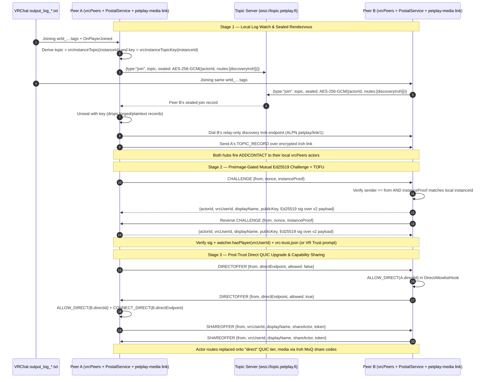

# VRChat Peer Discovery & Multiplayer Connection Security

How PetPlay discovers other PetPlay users in the same VRChat instance, authenticates them without VRChat API credentials, upgrades trusted peers to direct P2P, and isolates untrusted peers from your IP address, local actors, and shared displays.

Written against the current implementation; every claim cites the corresponding `path:line`.

---

## Quick Privacy Summary (ELI5)

What stays private — and what doesn't — in each situation:

| Concern | Private / Friends / Invite / Group instance (before Trust) | Public instance (before Trust) | After you click **Trust** (connected P2P) |
| --- | --- | --- | --- |
| **My IP address?** | **Hidden from other players.** Discovery runs strictly through an Iroh relay with UDP/IP turned off. *(The topic server & Iroh relay still see your IP as the network connection, never shared with other users.)* | **Hidden from other players.** Same relay-only discovery — strangers in public worlds cannot pull your IP. | **Shared with that trusted friend only** (for direct low-latency QUIC holepunching), guarded by an endpoint allowlist. |
| **My VRChat password / cookies / API token?** | **Never used.** PetPlay only reads VRChat's local `output_log_*.txt` on your own PC. | **Never used.** | **Never used.** |
| **Which world / private instance I'm in?** | **Hidden from the topic server & outsiders.** The server only sees an opaque hash (`vrc-inst-...`) and encrypted blobs; the private `~nonce(...)` acts as the key. | **Public anyway.** Anyone in VRChat can see public instance IDs, and the server could dictionary-check popular public worlds. | **Only known to people in the same instance.** |
| **My VRChat name & `usr_...`?** | **Hidden from the topic server & outsiders.** Only revealed inside an encrypted Iroh handshake to someone who already proves they know the exact raw `instanceId`. | **Visible to other PetPlay users in that same public instance** who run the handshake (they can already see you in-game). Still hidden from the topic server. | **Known to that friend** (verified by Ed25519 key + local VRChat log). |
| **My screens / desktop / mouse & keyboard?** | **Completely locked.** Nothing is shared, and no input is accepted. | **Completely locked.** | **Only what you explicitly share.** Each trusted friend gets a per-peer token; input only works on screens/windows where you enable input. |
| **Running code / changing my PetPlay settings?** | **Blocked.** Untrusted discovery connections are strictly allowlisted to handshake/offer messages only. | **Blocked.** | **Settings/admin stay local-only.** Trusted peers cannot trust third parties, force-share monitors, or change your config; shared P2P compute is allowed on the direct link. |
| **Someone pretending to be my friend?** | **Blocked from outside the instance** (can't unseal records or pass the raw `instanceId` proof). **Blocked for already-pinned friends** (`key_mismatch` warning). | **Blocked for already-pinned friends** (`key_mismatch`). On very first trust of a new friend in a public world, check their 12-char key fingerprint in voice/chat. | **Pinned permanently** in `vrc-trust.json` (`usr_... -> Ed25519 key`). Future sessions auto-trust only that key. |
| **Leaving the world or clicking Untrust?** | N/A — nothing was granted. | N/A — nothing was granted. | **Instant cutoff.** Their display token is revoked, their displays close, they are removed from the direct allowlist, and the direct QUIC connection is closed immediately. |
| **What does `topic.petplay.fi` itself see?** | Only your WebSocket IP, join/leave timing, opaque `vrc-inst-<hash>`, and encrypted blobs — **no** world ID, actor ID, Iroh ID, or VRChat name. *(It can still infer which IPs are in the same opaque topic at once.)* | Same, except popular public world hashes could theoretically be guessed offline. | **Nothing after discovery.** All direct P2P traffic, screens, audio, and input bypass the topic server completely. |

---

## 1. Design Goals & Trust Boundaries

1. **Zero VRChat API credentials**: PetPlay never asks for VRChat cookies, passwords, or 2FA tokens. Instance membership is derived purely from VRChat's local `output_log_*.txt`.
2. **Untrusted rendezvous server**: The public topic server (`wss://topic.petplay.fi`, `submodules/petplayserver/server.ts`) is treated as an untrusted, stateless pub/sub relay. For private/friends/invite/group instances, it must not learn the world/instance ID, actor IDs, Iroh node IDs, relay URLs, or VRChat identities, and it must not be able to forge peer announcements.
3. **Zero IP leak before mutual trust**: Untrusted peers on a topic (including a malicious topic server or strangers in a public VRChat instance) must never learn your IP address, mitigating `iroh#3535`.
4. **Explicit TOFU trust with key pinning**: A peer must prove both (a) live possession of a persistent Ed25519 key, (b) knowledge of the raw VRChat `instanceId`, and (c) live presence in your local VRChat instance before even a VR trust prompt is shown.
5. **Least privilege & instant revocation**: Untrusted discovery connections are strictly message-allowlisted. Even after trust, local admin actions remain unreachable remotely, and leaving the instance or clicking Untrust immediately revokes capability tokens and tears down direct QUIC connections.

---

## 2. End-to-End Architecture & Sequence



---

## 3. Protocol Stages in Detail

### 3.1 Local VRChat Log Parsing (Zero Credentials)

`vrcPeers` (`petplay/vrcPeers.ts`) polls VRChat's newest `output_log_*.txt` via `VrcLogWatcher` (`classes/vrc/logParser.ts:149-248`) every `1000 ms` (`DEFAULT_POLL_MS`).

- On first attach (or if the log file rotates/truncates), it reads from byte `0` so it recovers your user, world, instance, and player list even if PetPlay launches after VRChat.
- Tracked log lines (`classes/vrc/logParser.ts:33-39`):
  - Local identity (`self`): `Preforming/Performing post login checks for <name> (<usr_...>)` or `User Authenticated: <name> (<usr_...>)`.
  - Room/instance: `[Behaviour] Entering Room: <worldName>`, `[Behaviour] Joining (wrld_\S+)`, and `[Behaviour] OnLeftRoom`.
  - Live roster (`players`): `[Behaviour] OnPlayerJoined <name> (<usr_...>)` and `[Behaviour] OnPlayerLeft <name> (<usr_...>)`.

### 3.2 Cryptographic Primitives & Key Derivation

All VRChat identity and instance derivations live in `classes/vrc/identity.ts`:

| Artifact | Derivation | Purpose & Exposure |
| --- | --- | --- |
| **Persistent Identity** (`identity.json`) | Web Crypto `Ed25519` keypair stored as JWK (`classes/vrc/identity.ts:201-239`) | Survives restarts even though Iroh node IDs are ephemeral. Never leaves the machine except the raw 32-byte public key (base64url) during `CHALLENGE`. |
| **Key Fingerprint** | First 6 bytes (hex `xxxx-xxxx-xxxx`) of `SHA-256("petplay:id:" \|\| publicKey)` (`:67-71`) | Human-readable verification string shown in the VR TOFU prompt. |
| **Topic Name** (`vrcInstanceTopic`) | `"vrc-inst-" \|\| hex(SHA-256("petplay:vrc:instance:v1:" \|\| instanceId)[0..16])` (`:74-80`) | Sent to the public topic server. Hides raw `wrld_...` and `~nonce(...)` tags. |
| **Topic Sealing Key** (`vrcInstanceTopicKey`) | `base64url(SHA-256("petplay:vrc:topic-key:v1:" \|\| instanceId))` (256-bit) (`:87-93`) | Domain-separated AES-256-GCM key used locally to seal/unseal topic records. Never sent on the wire. |
| **Preimage Proof** (`instancePreimageProof`) | `base64url(SHA-256("petplay:vrc:preimage:v1\|" \|\| instanceId \|\| "\|" \|\| from \|\| "\|" \|\| to \|\| "\|" \|\| nonce))` (`:104-117`) | Sent in `CHALLENGE` requests to prove knowledge of the raw `instanceId` before the responder reveals `vrcUserId`/`displayName`/`publicKey`. |
| **Challenge Signature** (`signChallenge`) | `Ed25519.sign(privateKey, "petplay:vrc:challenge:v2\|" \|\| actorId \|\| "\|" \|\| vrcUserId \|\| "\|" \|\| instanceId \|\| "\|" \|\| nonce)` (`:137-157`) | Proves live key possession AND knowledge of the raw `instanceId`, bound to `(actorId, vrcUserId, nonce)`. |

### 3.3 Sealed Topic Rendezvous (`topic.petplay.fi`)

When `vrcPeers` enters an instance (`petplay/vrcPeers.ts:393-422`), it derives both `vrcInstanceTopic(instanceId)` and `vrcInstanceTopicKey(instanceId)`, leaves any previous topic, notifies `displayShare` via `SETINSTANCETOPIC { topic, key }`, and joins the topic via `PostMan.setTopic(topic, { key })`.

In Stageforge (`submodules/stageforge/src/lib/SignalingClient.ts:69-123` and `PostalService.ts:762-799, 955-974`):

1. **Sealing on publish**: Every outgoing `join`, `leave`, and periodic re-announcement on a keyed topic encrypts `{ actorId, routes }` with **AES-256-GCM**, a fresh 12-byte random IV, and AAD `stageforge:topic:v1|<type>|<topic>`. The topic key is captured synchronously *before* awaiting Iroh startup so a fast `delTopic` cannot cause an in-flight `join` to fall back to plaintext (`PostalService.ts:762-773`).
2. **Wire format on `wss://topic.petplay.fi`**:
   ```json
   {
     "type": "join",
     "topic": "vrc-inst-<32 hex chars>",
     "sealed": "<base64url(12-byte IV || AES-256-GCM ciphertext + 16-byte tag)>"
   }
   ```
3. **Stateless server**: `submodules/petplayserver/server.ts:90-118` inspects only `type` and `topic` (never `actorId`, `routes`, or `sealed`) and relays the JSON verbatim to sockets subscribed to `topic`. It keeps zero persistent state.
4. **Unsealing & downgrade rejection**: `PostalService.onWireTopicRecord` (`PostalService.ts:775-789`) unseals `SealedTopicRecord`s using the local topic key and **drops any plaintext `TopicRecord` arriving on a keyed topic**, preventing a malicious topic server from injecting unauthenticated joins or downgrading encryption.
5. **Late-joiner introduction**: Because the topic server stores no history, an already-present peer receives the late joiner's sealed `join`, unseals it, dials the late joiner's discovery Iroh endpoint, and sends its own `TOPIC_RECORD` directly over the encrypted Iroh connection (`PostalService.ts:744-750`). Both hubs then deliver `ADDCONTACT` to their local `vrcPeers` actors.

### 3.4 Two-Tier Iroh Transport (`petplay-media link`)

Stageforge's `irohCarrier` (`classes/irohCarrier.ts`) spawns a `petplay-media link` child process (`submodules/petplay_mediatransport/src/link.rs`) that owns **two isolated Iroh endpoints** (ALPN `petplay/link/1`, length-prefixed UTF-8 actor frames):

| Tier | Creation | Network Transports | Published on Topic Server? | Access Control |
| --- | --- | --- | --- | --- |
| **`discovery`** | At startup (`link.rs:146-158`) | `.clear_ip_transports()` — **strictly relay-only**, binds **no UDP socket**, advertises **zero IP candidates** | Yes (inside AES-GCM `sealed` payload) | Any peer with the topic key can dial; messages gated by `petplayRemotePolicy` discovery allowlist |
| **`direct`** | Lazily on demand via `DIRECT_ENDPOINT` (`link.rs:246-288`) | Full UDP/IP + relay QUIC NAT holepunching | **Never** (exchanged only over encrypted `discovery` link after trust) | `DirectAllowlistHook` in `EndpointHooks::after_handshake` rejects non-allowlisted `EndpointId`s with QUIC error `403` (`"untrusted peer"`) (`link.rs:81-96`) |

Because the discovery endpoint never binds a UDP socket or advertises IP addresses, an untrusted peer cannot trigger direct holepunching or learn your IP address (mitigating `iroh#3535`).

### 3.5 Preimage-Gated Mutual Ed25519 Challenge & TOFU Trust

On `ADDCONTACT` for any `vrcPeers@*` actor, `handshakePeer()` (`petplay/vrcPeers.ts:446-520`) runs a mutual challenge-response over the encrypted relay-only `discovery` connection:

1. **Preimage check before any response** (`petplay/vrcPeers.ts:752-795`):
   - The initiator sends `CHALLENGE { from, nonce, instanceProof }` (16-byte random base64url `nonce`, 10 s timeout).
   - The responder verifies:
     1. `PostMan.sender === request.from` (anti-spoofing).
     2. `verifyInstancePreimageProof(...)` in constant time against its own local `state.instanceId`, `request.from`, `state.id`, and `request.nonce`.
   - If either check fails, the responder returns `null` immediately — revealing no `vrcUserId`, `displayName`, `publicKey`, or signature, and triggering no reverse handshake.
   - Because `instanceProof` binds `(from, to, nonce)`, a malicious peer cannot replay an incoming proof back to the sender or to a third peer.
2. **Signature verification & two-factor trust evaluation** (`classes/vrc/identity.ts:297-302`, `petplay/vrcPeers.ts:478-514`):
   - The responder signs `petplay:vrc:challenge:v2|<actorId>|<vrcUserId>|<instanceId>|<nonce>` with its Ed25519 private key and returns `{ actorId, vrcUserId, displayName, publicKey, signature }` (never sending `instanceId`).
   - The initiator verifies the Ed25519 signature against its own local `instanceId`, then evaluates:
     1. **Live instance presence**: `watcher.hasPlayer(vrcUserId)` from the local VRChat log. If false → `"not_in_instance"` (no prompt, no sharing).
     2. **Local TOFU pin store** (`vrc-trust.json`, `VrcTrustStore`):
        - Pinned `usr_...` with matching `publicKey` → `"trusted"` (auto-trusted in all future sessions/instances).
        - Unknown `usr_...` → `"pending"`.
        - Pinned `usr_...` with different `publicKey` → `"key_mismatch"`.
3. **In-VR TOFU confirmation**:
   - `vrcPeers` pushes `VRCPEERSUPDATE` to `webxr` → `vrcTofuStore` (`classes/environment/vrcTofuStore.ts`) → `VrcTofuPromptOverlay` (`classes/environment/vrcTofuPromptOverlay.tsx`).
   - Only peers with `inInstance === true` and `trust === "pending" | "key_mismatch"` spawn a world-anchored VR card showing display name + fingerprint (and the previously pinned fingerprint on `key_mismatch`) with **Trust / Ignore** buttons.
   - Clicking **Trust** invokes local-only `vrcPeers.TRUST`, pinning `usr_... -> publicKey` atomically in `vrc-trust.json` and re-evaluating peers.

### 3.6 Remote Message Policy (`classes/remotePolicy.ts`)

`PostalService.setRemotePolicy(petplayRemotePolicy())` (`petplay/petplayServer.ts:244`) gates every incoming remote actor message by connection tier (`classes/remotePolicy.ts:18-75`):

- **Always blocked remotely (`LOCAL_ONLY_BY_ACTOR`)** — even on trusted `"direct"` connections:
  - `vrcPeers`: `TRUST`, `UNTRUST`, `CONFIGURE`, `SIMULATEPEER`, `CLEARSIMULATED`, `ASSIGNSHARING`, `ASSIGNWEBXR`.
  - `displayShare`: `SETUP`, `GRANTPEER`, `REVOKEPEER`, `SETINSTANCETOPIC`, `SETSHARED`, `SHAREALL`.
- **`"discovery"` tier (untrusted, relay-only)**:
  - Strictly allowlisted to `CHALLENGE`, `SHAREOFFER`, `DIRECTOFFER` on `vrcPeers`, and `GUARDED` on `displayShare` / `desktopSource` / `desktopInput` / `householdDesktops`.
  - All other messages (`EVALJS`, `HOTPATCH`, `SHUTDOWN*`, `__HEALTH__`, etc.) are rejected with `remote message "<type>" rejected by policy`.
- **`"direct"` tier (mutually trusted P2P)**:
  - General actor RPCs and shared P2P compute (`EVALJS`, etc.) are allowed, subject to `LOCAL_ONLY_BY_ACTOR`.

### 3.7 Post-Trust Direct Upgrade & Capability-Based Display Sharing

Only when a peer is both `trust === "trusted"` and `inInstance === true` does `syncSharingForPeer()` (`petplay/vrcPeers.ts:298-318`) activate:

1. **Direct QUIC P2P upgrade** (`upgradePeerToDirect`, `petplay/vrcPeers.ts:178-264`):
   - Calls `System.DIRECT_ENDPOINT` to lazily start the IP-capable Iroh endpoint.
   - Exchanges `DIRECTOFFER { from, endpoint, allowed }` (validated against `PostMan.sender`).
   - Adds the trusted peer's direct `EndpointId` via `System.ALLOW_DIRECT`, replies with `allowed: true`, and once the remote side confirms `allowed: true`, calls `System.CONNECT_DIRECT { endpoint, actors: [peer.actorId, shareActor] }`.
   - `CONNECT_DIRECT` dials the direct endpoint and calls `connection.attach(actorId, { replace: true })` (`PostalService.ts:931-935`), moving actor traffic off the relay onto the `"direct"` tier.
2. **Per-peer revocable display sharing** (`grantPeerSharing`, `petplay/vrcPeers.ts:140-176`, `petplay/displayShare.ts:399-475`, `petplay/householdDesktops.ts:645-673`):
   - Calls `displayShare.GRANTPEER { peerKey: peer.vrcUserId }` to mint a 24-byte random base64url capability token scoped to that peer.
   - Sends `SHAREOFFER { from, vrcUserId, displayName, shareActor, token }` (validated against `PostMan.sender`).
   - The receiver registers `{ source: shareActor, proof: token, label }` with `householdDesktops` via `ADDPEERSOURCE`.
   - All display operations (`DESCRIBE`, `FEED`, `START`, `STOP`, `AUDIO`, `STOPAUDIO`, `INPUT`, `FOCUSWINDOW`, `SETPOSE`) travel as `GUARDED { proof, type, payload }`, checked in constant time (`sameToken`, `displayShare.ts:89-102`).
   - Only explicitly shared monitors/windows are listed or startable; `INPUT` is additionally bounds-checked against regions that have `input: true` (`displayShare.ts:224-243`).
   - Video and audio streams use Iroh MoQ share codes (`feed.code`) returned by `FEED`/`START`/`AUDIO` and decoded in a process-isolated `remoteMediaOverlay` / `petplay-media receive-audio`.

### 3.8 Automatic Revocation & Teardown

Any of the following immediately invokes `revokePeerSharing()` (`petplay/vrcPeers.ts:266-296`):
- Peer leaves the VRChat instance (`OnPlayerLeft` → `inInstance` becomes `false`).
- Peer disconnects from the topic (`REMOVECONTACT`).
- User untrusts the peer (`UNTRUST`).
- Local user switches worlds or leaves the room (`switchInstanceTopic` → `clearAllPeerSharing`).

Revocation performs three actions synchronously:
1. `displayShare.REVOKEPEER` — deletes the peer's capability token so further `GUARDED` calls immediately fail.
2. `householdDesktops.REMOVEPEERSOURCE` — tears down the peer's overlays and audio players.
3. `System.REVOKE_DIRECT` — removes the peer's `EndpointId` from `DirectAllowlistHook` and immediately closes any active `"direct"` QUIC connection (`link.rs:337-357`, `PostalService.ts:914-923`).

---

## 4. Threat Model Matrix

| Adversary | What They Can Observe | What They Cannot Do |
| --- | --- | --- |
| **Passive / compromised topic server** (`topic.petplay.fi`) — **Private / Friends / Invite / Group instance** | Client WebSocket IP, join/leave timestamps, opaque `vrc-inst-<hash>`, opaque `sealed` ciphertext sizes, co-presence (which WebSockets are in the same opaque topic at once). | Cannot read `wrld_...` / instance nonce, `actorId`, Iroh node ID, relay URL, or `usr_...`. Cannot dial your Iroh endpoint. Cannot forge a `join` record (AES-GCM tag fails; plaintext rejected). Cannot trigger a VR trust popup. |
| **Passive / compromised topic server** — **Public instance** | Same as above; could additionally dictionary-crack `vrc-inst-<hash>` for popular public `wrld_...:<digits>~region(...)` strings and derive the topic key. | Still cannot learn your IP over Iroh (discovery is relay-only), cannot run `EVALJS` or admin methods (`petplayRemotePolicy`), cannot trigger a trust popup unless claiming a `usr_...` actually in that public instance, and cannot impersonate any already-pinned peer (`key_mismatch`). |
| **Stranger on the topic server** (not in your instance) | Nothing — `server.ts` only relays to sockets subscribed to that exact `topic`. | Cannot enumerate active instances. For private instances, cannot compute `topic` or `key`. Even with a leaked topic hash, cannot unseal records or pass `CHALLENGE` without the raw `instanceId`. |
| **Untrusted player in the same VRChat instance** | Knows `instanceId` → can unseal `join` records, dial your relay-only discovery Iroh ID, and complete `CHALLENGE` (learning your `vrcUserId`, `displayName`, `publicKey`). | Cannot learn your IP address (discovery endpoint has no IP transports). Cannot run `EVALJS`, read/control your screens, or call admin methods. Cannot impersonate an already-pinned friend (`key_mismatch`). |
| **Trusted peer** (after mutual TOFU Trust) | Learns your direct IP (via QUIC holepunching on the `direct` endpoint), can access monitors/windows you explicitly share, and can send `direct`-tier actor messages (e.g. shared compute). | Cannot invoke `LOCAL_ONLY_BY_ACTOR` admin methods (`TRUST`, `UNTRUST`, `GRANTPEER`, `SETSHARED`, `SHAREALL`, etc.). Cannot drive monitors/windows where `input: false`. Loses access and direct QUIC connection immediately on `UNTRUST` or instance leave. |

---

## 5. Residual Risks & Non-Goals

1. **Co-presence metadata on the topic server**: Even with sealed records, the topic server sees which client IPs join the same opaque `vrc-inst-<hash>` at the same time. Future mitigation: pairwise rendezvous topics derived from pinned Ed25519 keys for already-trusted friends, and/or replacing the central topic server with a DHT.
2. **Public-instance predictability**: Public VRChat instances have low-entropy IDs (`wrld_<uuid>:<digits>~region(<r>)`), so `vrcInstanceTopic` / `vrcInstanceTopicKey` (fast SHA-256) are not secret for public worlds. Security in public instances relies on relay-only discovery, `petplayRemotePolicy`, Ed25519 TOFU pinning, and out-of-band / in-voice fingerprint verification on first trust.
3. **First-time TOFU impersonation inside the same instance**: If an attacker is *actually* in the same VRChat instance as you and an unpinned friend Alice (who is not running PetPlay), the attacker can claim `vrcUserId = usr_alice` and trigger a `"pending"` trust prompt for Alice. Defended by verifying Alice's key fingerprint in voice/chat before clicking Trust (and once pinned, future impersonators are flagged `key_mismatch`).
4. **Iroh relay metadata**: During discovery (before direct P2P upgrade), the Iroh relay server sees your IP and encrypted QUIC packets routed by discovery `EndpointId`, though all payload contents remain end-to-end encrypted by Iroh QUIC/TLS.
5. **Media share codes (`feed.code`)**: Once a trusted peer receives a MoQ share code from `displayShare`, media transport is encrypted over Iroh; restricting `petplay-media` publishers to specific viewer Iroh `EndpointId`s (as noted in `markdown/rdp/peers.md:62`) is still an open hardening item.

---

## 6. Automated Verification

- `tests/vrc/identity.test.ts` — Ed25519 identity persistence, `vrcInstanceTopic`, `vrcInstanceTopicKey`, `instancePreimageProof` / `verifyInstancePreimageProof` (including hash-only and reversed-direction rejection), `signChallenge` / `verifyChallenge` (v2 raw `instanceId` binding), and `VrcTrustStore` TOFU pinning / `key_mismatch` / `force` re-trust.
- `tests/vrc/vrcPeers.test.ts` — End-to-end two-process discovery over Iroh: verifies every topic-server WebSocket frame is sealed (no plaintext `actorId`, `routes`, `vrcPeers@`, or `wrld_`), forged plaintext and corrupted sealed topic records are ignored, invalid/spoofed `CHALLENGE` probes return `null`, TOFU trust pins and auto-trusts on reconnect, and key mismatch is caught.
- `tests/vrc/remoteSecurity.test.ts` — Verifies the `discovery` endpoint binds no IP addresses (relay-only), the `direct` endpoint rejects non-allowlisted peers via `DirectAllowlistHook`, `petplayRemotePolicy` blocks `EVALJS` and admin ops before trust, upgrades to direct P2P after trust, and keeps `LOCAL_ONLY_BY_ACTOR` blocked even after trust.
- `tests/vrc/vrcShareE2e.test.ts` — End-to-end VRC discovery + TOFU trust → per-peer `displayShare` capability tokens, input gating, and revocation without `.secret`.
